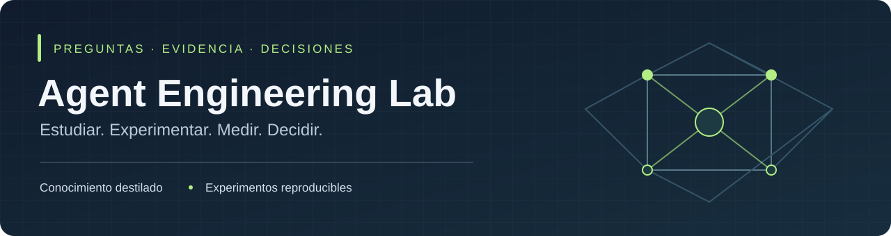

<p align="center"></p>

<p align="center">
  <strong>Entender una decisión. Ejecutar un experimento. Verificar el resultado.</strong>
</p>

<p align="center">
  <a href="docs/index.md">Conocimiento</a> ·
  <a href="experiments/README.md">Experimentos</a> ·
  <a href="docs/project-guide.md">Método de trabajo</a> ·
  <a href="docs/templates/experiment.md">Diseñar un estudio</a>
</p>

---

## Qué es este proyecto

Un laboratorio personal para desarrollar criterio técnico en Agent Engineering: estudiar una pregunta concreta, comparar alternativas y publicar lo que la evidencia permite concluir.

Aquí viven conocimiento destilado, decisiones técnicas y experimentos reproducibles. El temario completo, los borradores y la memoria personal se mantienen en un espacio privado de estudio.

**Estado actual:** estructura y metodología preparadas. El primer experimento está pendiente de elección por el autor. No hay resultados experimentales publicados.

## Explorar el laboratorio

| Quiero… | Empieza aquí |
|---|---|
| Entender el método y el alcance | [Guía del proyecto](docs/project-guide.md) |
| Leer conocimiento consolidado | [Índice de documentación](docs/index.md) |
| Ver experimentos y sus resultados | [Registro de experimentos](experiments/README.md) |
| Entender las decisiones de organización | [Decisión 001](docs/decisions/001-repository-boundaries.md) |
| Preparar una nota técnica | [Plantilla de concepto](docs/templates/concept.md) |
| Diseñar un experimento | [Plantilla de experimento](docs/templates/experiment.md) |
| Documentar resultados | [Plantilla de resultados](docs/templates/results.md) |
| Trabajar con un coding agent | [AGENTS.md](AGENTS.md) |

## El ciclo de trabajo

**Pregunta → estudio → hipótesis → comparación → evidencia → decisión.**

1. El autor elige la pregunta que quiere investigar.
2. Se estudian fuentes y se registran borradores en privado.
3. Se define el mínimo estudio que pueda responder a la pregunta.
4. Se fijan baseline, datos, métricas y límites antes de ejecutar.
5. Se publican resultados, fallos y limitaciones.
6. Se explica qué decisión cambia y bajo qué condiciones.

Una conclusión bien defendida puede ser útil sin un experimento. Un resultado negativo bien analizado también es evidencia.

## Estructura

```text
agent-engineering-lab/
├── README.md
├── AGENTS.md
├── docs/
│   ├── index.md
│   ├── project-guide.md
│   ├── concepts/
│   ├── decisions/
│   ├── templates/
│   └── assets/
├── experiments/
├── src/
├── tests/
└── .github/
    └── ISSUE_TEMPLATE/
```

Las carpetas de conceptos, experimentos, código y tests tienen guías de uso. Las plantillas son herramientas de trabajo, no experimentos realizados.

## Stack previsto

**Python · uv · Ruff · Pytest · GitHub Actions.**

El entorno, el lockfile y la CI de código se incorporarán junto con el primer experimento elegido que requiera programación. Esta base documental se puede explorar sin instalar dependencias, usar claves ni ejecutar modelos.

El código compartido se extraerá cuando varios experimentos lo necesiten. Las evaluaciones con modelos reales tendrán ejecución separada, límites de gasto y configuración documentada.

## Criterio de publicación

Cada resultado debe identificar su pregunta, metodología, procedencia de los datos y límites. Cada nota debe distinguir fuentes, interpretación y evidencia. Un ejemplo funcionando no demuestra rendimiento ni fiabilidad.

Consulta la [guía](docs/project-guide.md) para preparar una publicación y la [decisión de separación de espacios](docs/decisions/001-repository-boundaries.md) para entender qué pertenece al repositorio.

**Licencia:** pendiente de elección.
